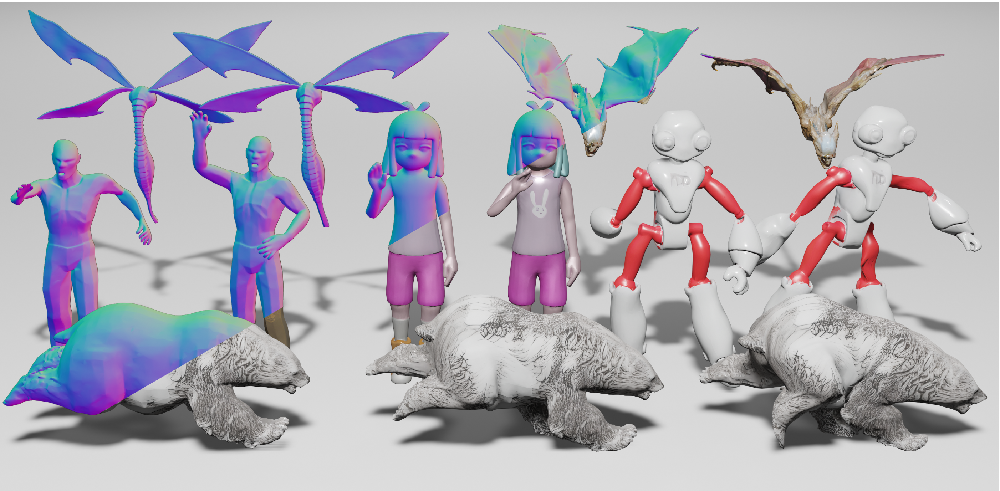

## ___***Mesh4D: 4D Mesh Reconstruction and Tracking from Monocular Video***___
<p align="center">
  
</p>

## [Paper](https://arxiv.org/pdf/2601.05251) | [Video Youtube](https://youtu.be/Qqo6QQjXuB0) | [Project Page](https://mesh-4d.github.io/) 

<p align="center">
 
</p>

## 🔥 News

- Nov 7, 2026: Sixteen-frame checkpoints, inference, and benchmark rendering are available.
- Jan 9, 2026: 🤗 We release the first version of Mesh4D!
- Nov 5, 2026: 🤗 We release the MeshBench Bechmark and visualization code!


## ⚙️ Setup

### Install Environment via Anaconda (Recommended)
```bash
conda create -n mesh4d python=3.10.18
conda activate mesh4d
```

We test our model with Python 3.10 and PyTorch 2.5.1+cu124.
```bash
pip install torch==2.5.1 torchvision==0.20.1 torchaudio==2.5.1 --index-url https://download.pytorch.org/whl/cu124
pip install -r requirements.txt

cd hy3dpaint/custom_rasterizer
pip install -e .
cd ../..
cd hy3dpaint/DifferentiableRenderer
bash compile_mesh_painter.sh
cd ../..

wget https://github.com/xinntao/Real-ESRGAN/releases/download/v0.1.0/RealESRGAN_x4plus.pth -P hy3dpaint/ckpt

cd hy3dshape
python ./setup_im2mesh.py build_ext --inplace
cd ..
```

Download the original six-frame model checkpoints:
```bash
mkdir ckpt
gdown 1e9YGQAuFr5BDN2--srDEMnoULb4ZP5sx -O ./ckpt/ # deformation vae
gdown 1jeNwiP9-B1uyKvk3_yBN7Y9-D7YQxBc5 -O ./ckpt/ # denoiser
```

For the newer **sixteen-frame** VAE and denoiser, use the
[checkpoint downloader](checkpoints/README.md). It downloads the complete files from
[zerenjiang/Mesh4D_16 on Hugging Face](https://huggingface.co/zerenjiang/Mesh4D_16)
into `ckpt/16frames/` and verifies their SHA-256 checksums:

```bash
python -m pip install 'huggingface-hub==0.30.2'
python checkpoints/download.py
```

## 😈 Inference
We provide some preprocessed in-the-wild image sequences from Consistent4D dataset `./DATA/` for inference:
```bash 
cd hy3dshape
python infer.py
```
For other in-the-wild videos, you need to first segment foreground object out and save it as a sequence of RGBA images with white background.

For **sixteen-frame inference**, run from the repository root with 16 segmented
RGBA frames named `0.png` through `15.png`:

```bash
python hy3dshape/infer_16.py --input-dir /path/to/rgba_frames --dry-run
python hy3dshape/infer_16.py --input-dir /path/to/rgba_frames \
  --output-dir hy3dshape/output_folder/test/my_video_16
```

See the [sixteen-frame guide](hy3dshape/INFERENCE_16.md) for checkpoint overrides,
custom frame names, resuming a run, benchmark inputs, and evaluation alignment.

## 😸 Evaluation
See [the benchmark guide](benchmark/README.md) for the
[benchmark download folder](https://drive.google.com/drive/folders/12kzy9YTctkNNIWELhXboiaM0vNhK9nFn),
checksum-verified extraction, clip definitions, and rendered-image evaluation.
The benchmark contains 40 animated GLBs and 50 evaluation clips from 39 objects;
the six-frame and sixteen-frame protocols use 50 and 48 clips, respectively.

After obtaining the benchmark archives and rendering your predictions, run from
the repository root:

```bash
python -m pip install -r benchmark/requirements.txt
python benchmark/download.py --archive-dir /path/to/archives --skip-download
python benchmark/evaluate.py \
  --benchmark-root data/mesh4d_benchmark \
  --pred-root /path/to/prediction_renders \
  --frames 6 --output-dir benchmark/results/mesh4d_6
```

The evaluator reports PSNR, SSIM, LPIPS, and CLIP image similarity. It checks all
required frames before scoring and supports the original Mesh4D render layout.
The [sixteen-frame workflow](benchmark/README.md#sixteen-frame-inference-rendering-and-evaluation)
connects the new inference command, batch rendering with benchmark cameras,
and `--frames 16` evaluation over 48 clips.
Optional historical I3D scoring and alternate filename layouts are documented
in the guide. Archive publication to Drive has not yet been verified; local
archives can already be verified and extracted with the command above.

## 🌠 Visualization
Render animated Mesh4D GLBs as four-view PNG sequences with Blender 4.0, then
assemble a GIF or MP4 preview:

```bash
blender --background --python-exit-code 1 --python visualization/render.py -- \
  --input /path/to/combined_gen_mtl.glb \
  --output-dir visualization/results/example
python visualization/preview.py \
  --input-dir visualization/results/example \
  --output visualization/results/example.gif --fps 24
```

CPU rendering is the default; use `--device CUDA` or `--device OPTIX` for GPU
rendering. See [the visualization guide](visualization/README.md) for frame
selection, turntables, clay shading, benchmark cameras, and MP4 output.


## Acknowledgements

We have used codes from other great research work, including [Hunyuan3D-2.1](https://github.com/Tencent-Hunyuan/Hunyuan3D-2.1), [TripoSG](https://github.com/VAST-AI-Research/TripoSG/tree/main), [Motion2VecSets](https://github.com/VVeiCao/Motion2VecSets), [Consistent4D](https://github.com/yanqinJiang/Consistent4D), and [Diffusion4D](https://github.com/VITA-Group/Diffusion4D). We sincerely thank the authors for their awesome work!

## 🔗 BibTeX

If you find Mesh4D useful for your research and applications, please cite us using this BibTex:
```bibtex
@misc{jiang2026mesh4d,
      title={Mesh4D: 4D Mesh Reconstruction and Tracking from Monocular Video}, 
      author={Zeren Jiang and Chuanxia Zheng and Iro Laina and Diane Larlus and Andrea Vedaldi},
      year={2026},
      eprint={2601.05251},
      archivePrefix={arXiv},
      primaryClass={cs.CV},
      url={https://arxiv.org/abs/2601.05251}, 
}
```

<!-- ## Star History

<a href="https://star-history.com/#Tencent-Hunyuan/Hunyuan3D-2.1&Date">
 <picture>
   <source media="(prefers-color-scheme: dark)" srcset="https://api.star-history.com/svg?repos=Tencent-Hunyuan/Hunyuan3D-2.1&type=Date&theme=dark" />
   <source media="(prefers-color-scheme: light)" srcset="https://api.star-history.com/svg?repos=Tencent-Hunyuan/Hunyuan3D-2.1&type=Date" />
   
 </picture>
</a> -->
